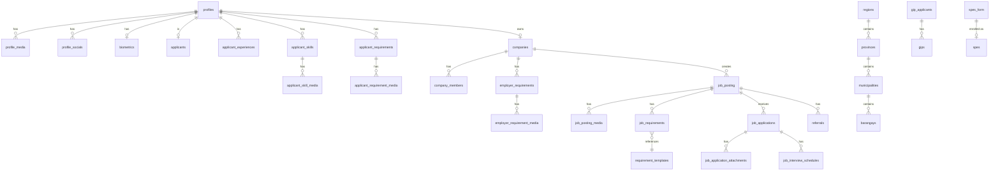

# AGSURJOBS — Database Agent

> **Purpose**: This document is the authoritative reference for the AGSURJOBS database architecture.
> Any AI agent writing queries, creating types, or modifying schema-related code MUST follow these rules.

---

## 1. Database Overview

| Property            | Value                                                   |
| ------------------- | ------------------------------------------------------- |
| **Provider**        | Supabase (managed PostgreSQL)                            |
| **Project ID**      | `otixooaxfcvjgrlaxihj`                                  |
| **Schemas**         | 7: `public`, `core`, `applicants`, `employers`, `jobs`, `system`, `esmdd` |
| **Type Generation** | Auto-generated via `npm run types:gen`                   |
| **Type File**       | [`src/types/database.types.ts`](file:///c:/Users/Denmark%20B.%20Rivera/OneDrive/Documents/Work/vue-agsurjobs/src/types/database.types.ts) (1803 lines, DO NOT EDIT) |
| **Access Pattern**  | Supabase JS client with typed multi-schema queries       |
| **Security**        | Row Level Security (RLS) on all tables                   |

---

## 2. Schema Architecture

```
┌─────────────────────────────────────────────────────────────────┐
│                        PostgreSQL Instance                       │
│                                                                  │
│  ┌──────────┐  ┌──────────┐  ┌────────────┐  ┌──────────────┐  │
│  │  public   │  │   core   │  │ applicants │  │  employers   │  │
│  │ (shared)  │  │ (users)  │  │ (job       │  │ (companies)  │  │
│  │           │  │          │  │  seekers)  │  │              │  │
│  └──────────┘  └──────────┘  └────────────┘  └──────────────┘  │
│                                                                  │
│  ┌──────────┐  ┌──────────┐  ┌────────────┐                     │
│  │   jobs   │  │  system  │  │   esmdd    │                     │
│  │ (hiring) │  │ (audit/  │  │ (PESO     │                     │
│  │          │  │  notif)  │  │  programs) │                     │
│  └──────────┘  └──────────┘  └────────────┘                     │
└─────────────────────────────────────────────────────────────────┘
```

---

## 3. Schema: `public` — Shared Reference Data

The `public` schema contains reference data shared across all roles.

### Tables

#### `regions`
Philippine regions (PSGC).

| Column       | Type      | Constraints    |
| ------------ | --------- | -------------- |
| `id`         | `uuid`    | PK, default    |
| `code`       | `text`    | NOT NULL       |
| `name`       | `text`    | NOT NULL       |
| `created_at` | `timestamptz` | nullable   |

#### `provinces`
Philippine provinces linked to regions.

| Column       | Type      | Constraints       |
| ------------ | --------- | ----------------- |
| `id`         | `uuid`    | PK, default       |
| `code`       | `text`    | NOT NULL          |
| `name`       | `text`    | NOT NULL          |
| `region_id`  | `uuid`    | FK → `regions.id` |
| `created_at` | `timestamptz` | nullable      |

#### `municipalities`
Philippine municipalities/cities linked to provinces.

| Column        | Type      | Constraints          |
| ------------- | --------- | -------------------- |
| `id`          | `uuid`    | PK, default          |
| `code`        | `text`    | NOT NULL             |
| `name`        | `text`    | NOT NULL             |
| `province_id` | `uuid`    | FK → `provinces.id`  |
| `is_city`     | `boolean` | nullable             |
| `created_at`  | `timestamptz` | nullable         |

#### `barangays`
Philippine barangays with LPII terrain classification.

| Column            | Type        | Constraints                |
| ----------------- | ----------- | -------------------------- |
| `id`              | `uuid`      | PK, default                |
| `code`            | `text`      | NOT NULL                   |
| `name`            | `text`      | NOT NULL                   |
| `municipality_id` | `uuid`      | FK → `municipalities.id`   |
| `lpii_tag`        | `lpii_type` | enum: `LOWLAND`, `UPLAND`, `WETLAND` |
| `created_at`      | `timestamptz` | nullable                 |

#### `requirement_templates`
Defines document requirement types for applicants and employers.

| Column             | Type   | Constraints   |
| ------------------ | ------ | ------------- |
| `id`               | `int4` | PK, serial    |
| `name`             | `text` | nullable      |
| `requirement_type` | `text` | nullable      |
| `description`      | `text` | nullable      |
| `created_at`       | `timestamptz` | default |
| `updated_at`       | `timestamptz` | nullable |

#### `document_templates`
Downloadable document templates categorized by role.

| Column        | Type      | Constraints      |
| ------------- | --------- | ---------------- |
| `id`          | `int4`    | PK, serial       |
| `title`       | `text`    | NOT NULL         |
| `description` | `text`    | nullable         |
| `category`    | `text`    | nullable         |
| `target_role` | `text`    | nullable         |
| `file_name`   | `text`    | nullable         |
| `file_path`   | `text`    | nullable         |
| `file_size`   | `int4`    | nullable         |
| `mime_type`   | `text`    | nullable         |
| `is_active`   | `boolean` | nullable         |
| `created_at`  | `timestamptz` | nullable     |
| `updated_at`  | `timestamptz` | nullable     |

#### `job_posting`
Job listings created by employers.

| Column                 | Type             | Constraints |
| ---------------------- | ---------------- | ----------- |
| `id`                   | `int4`           | PK, serial  |
| `employer_id`          | `int4`           | nullable    |
| `job_title`            | `text`           | nullable    |
| `job_description`      | `text`           | nullable    |
| `job_type`             | `text`           | nullable    |
| `location`             | `text`           | nullable    |
| `salary_min`           | `numeric`        | nullable    |
| `salary_max`           | `numeric`        | nullable    |
| `education_required`   | `text`           | nullable    |
| `experience_required`  | `text`           | nullable    |
| `vacancies`            | `int4`           | nullable    |
| `work_setup`           | `text`           | nullable    |
| `application_deadline` | `timestamptz`    | nullable    |
| `status`               | `job_status_type`| nullable    |

#### `job_posting_media`
Media attachments for job postings.

| Column           | Type   | FK                          |
| ---------------- | ------ | --------------------------- |
| `id`             | `int4` | PK, serial                  |
| `job_posting_id` | `int4` | FK → `job_posting.id`       |
| `path`, `filename`, `mime_type`, `size`, `alt_text`, `description` | various | nullable |

#### `job_requirements`
Requirement templates linked to specific job postings.

| Column                   | Type   | FK                                   |
| ------------------------ | ------ | ------------------------------------ |
| `id`                     | `int4` | PK, serial                           |
| `job_posting_id`         | `int4` | FK → `job_posting.id`                |
| `requirement_id`         | `int4` | FK → `requirement_templates.id`      |
| `additional_requirement` | `text` | nullable                             |

### Public Functions

| Function                | Args                    | Returns   | Purpose                      |
| ----------------------- | ----------------------- | --------- | ---------------------------- |
| `check_if_email_exists` | `target_email: text`    | `boolean` | Email uniqueness check (SECURITY DEFINER) |

### Public Enums

| Enum Name                | Values                                                          |
| ------------------------ | --------------------------------------------------------------- |
| `application_stage_type` | `applied`, `screened`, `interviewing`, `offered`, `hired`, `rejected` |
| `company_role_type`      | `owner`, `admin`, `hr`, `employee`                              |
| `gender_type`            | `male`, `female`, `non-binary`, `prefer_not_to_say`             |
| `job_status_type`        | `draft`, `active`, `paused`, `closed`                           |
| `lpii_type`              | `LOWLAND`, `UPLAND`, `WETLAND`                                  |
| `notification_type`      | `application_status`, `interview_alert`, `referral_update`, `compliance_alert`, `system_announcement` |
| `referral_outcome_type`  | `pending_feedback`, `hired`, `rejected`, `no_show`              |
| `status_type`            | `pending`, `approved`, `rejected`, `active`, `closed`           |
| `user_role`              | `applicant`, `employer`, `peso_staff`, `admin`                  |

---

## 4. Schema: `core` — User Profiles & Identity

The `core` schema manages user identity, profiles, and media.

### Tables

#### `profiles`
Central user table — one row per authenticated user.

| Column           | Type           | Constraints                |
| ---------------- | -------------- | -------------------------- |
| `id`             | `uuid`         | PK (matches `auth.users.id`) |
| `firstname`      | `text`         | nullable                   |
| `middlename`     | `text`         | nullable                   |
| `lastname`       | `text`         | nullable                   |
| `username`       | `text`         | nullable                   |
| `birthdate`      | `date`         | nullable                   |
| `gender`         | `gender_type`  | enum (core)                |
| `contact_number` | `text`         | nullable                   |
| `civil_status`   | `text`         | nullable                   |
| `religion`       | `text`         | nullable                   |
| `height`         | `text`         | nullable                   |
| `region`         | `text`         | nullable                   |
| `province`       | `text`         | nullable                   |
| `geographic`     | `text`         | nullable (municipality)    |
| `barangay`       | `text`         | nullable                   |
| `role`           | `user_role`    | enum (core)                |
| `status`         | `status_type`  | enum (core)                |
| `is_pwd`         | `boolean`      | nullable                   |
| `is_4ps`         | `boolean`      | nullable                   |
| `last_login`     | `timestamptz`  | nullable                   |
| `created_at`     | `timestamptz`  | default                    |
| `updated_at`     | `timestamptz`  | nullable                   |

#### `profile_media`
User avatar/photo uploads.

| Column       | Type   | FK                       |
| ------------ | ------ | ------------------------ |
| `id`         | `int4` | PK, serial               |
| `profile_id` | `uuid` | FK → `profiles.id`      |
| `path`, `filename`, `mime_type`, `size`, `alt_text`, `description` | various | nullable |

#### `profile_socials`
User social media links.

| Column        | Type   | FK                  |
| ------------- | ------ | ------------------- |
| `id`          | `int8` | PK, identity        |
| `profile_id`  | `uuid` | FK → `profiles.id` (cascade) |
| `social_name` | `text` | nullable            |
| `social_link` | `text` | nullable, UNIQUE across all profiles |
| `created_at`, `updated_at` | `timestamptz` | `updated_at` set by `trigger_profile_socials_updated_at` |

Migration `028_profile_socials.sql`: index `idx_profile_socials_profile_id`; RLS — any signed-in user reads (links show on profile pages), the owner (`profile_id = auth.uid()`) inserts / updates / deletes. UI: `ProfileSocials.vue` in the profile sidebar → `useProfileSocials` → `profileSocialStore` → `profileSocialService`.

#### `biometrics`
Face embeddings for biometric verification.

| Column            | Type   | FK                           |
| ----------------- | ------ | ---------------------------- |
| `id`              | `int4` | PK, serial                   |
| `user_id`         | `uuid` | FK → `profiles.id` (1-to-1) |
| `biometric_type`  | `text` | nullable                     |
| `face_embedding`  | `text` | nullable                     |
| `registered_at`   | `timestamptz` | default               |

### Core Functions

| Function           | Returns                         | Purpose                    |
| ------------------ | ------------------------------- | -------------------------- |
| `get_user_emails`  | `{email: text, id: uuid}[]`     | Fetch all emails from `auth.users` (SECURITY DEFINER) |

### Core Enums

| Enum Name      | Values                                                                     |
| -------------- | -------------------------------------------------------------------------- |
| `gender_type`  | `woman`, `man`, `cisgender_woman`, `cisgender_man`, `transgender_woman`, `transgender_man`, `non_binary`, `genderqueer`, `genderfluid`, `agender`, `two_spirit`, `intersex`, `different_identity`, `prefer_not_to_say` |
| `status_type`  | `pending`, `approved`, `rejected`, `active`, `inactive`                    |
| `user_role`    | `admin`, `applicant`, `company_owner`, `company_member`, `provincial_peso`, `municipal_peso`, `dole` |

> [!WARNING]
> Note the `core.user_role` enum has **different values** from `public.user_role`. The `core` enum is the canonical one used by `profiles.role`.

---

## 5. Schema: `applicants` — Job Seeker Data

### Tables

#### `applicants`
Full applicant profile with DOLE SIF-compliant fields.

| Key Fields                    | Type           | Notes                               |
| ----------------------------- | -------------- | ----------------------------------- |
| `id`                          | `uuid`         | PK                                  |
| `profile_id`                  | `uuid`         | FK → `core.profiles.id`            |
| `first_name`, `surname`, `middle_name`, `suffix` | `text` | Name fields             |
| `date_of_birth`               | `date`         | NOT NULL                            |
| `sex`, `civil_status`         | `text`         | nullable                            |
| `address`                     | `jsonb`        | Structured address object           |
| `employment_status`           | `text`         | nullable                            |
| `employment_type`             | `text`         | nullable                            |
| `educational_background`      | `jsonb`        | Array of education records          |
| `work_experiences`            | `jsonb`        | Array of work history               |
| `vocational_trainings`        | `jsonb`        | Array of training records           |
| `eligibilities`               | `jsonb`        | Array of eligibility records        |
| `language_proficiencies`      | `jsonb`        | Array of language skills            |
| `disabilities`                | `text[]`       | Array of disability types           |
| `is_4ps_beneficiary`          | `boolean`      | 4Ps program flag                    |
| `is_ofw`, `is_former_ofw`     | `boolean`      | OFW status flags                    |
| `preferred_occupations`       | `text[]`       | Job preferences                     |
| `preferred_local_locations`   | `text[]`       | Location preferences                |
| `referred_programs`           | `text[]`       | DOLE program referrals              |

#### `applicant_experiences`
Detailed work experience entries.

| Column        | Type   | FK                      |
| ------------- | ------ | ----------------------- |
| `id`          | `int4` | PK, serial              |
| `profile_id`  | `uuid` | FK → `core.profiles.id` |
| `job_title`   | `text` | nullable                |
| `company_name`| `text` | nullable                |
| `description` | `text` | NOT NULL                |
| `start_date`  | `date` | nullable                |
| `end_date`    | `date` | nullable                |

#### `applicant_skills`
Skills categorized by type.

| Column           | Type   | FK                      |
| ---------------- | ------ | ----------------------- |
| `id`             | `int4` | PK, serial              |
| `profile_id`     | `uuid` | FK → `core.profiles.id` |
| `skill_name`     | `text` | NOT NULL                |
| `skill_category` | `text` | NOT NULL                |

#### `applicant_skill_media`
Skill certification/proof uploads.

| Column              | Type   | FK                               |
| ------------------- | ------ | -------------------------------- |
| `id`                | `int4` | PK, serial                       |
| `applicant_skill_id`| `int4` | FK → `applicant_skills.id`       |
| `path`, `filename`, etc. | various | Standard media fields       |

#### `applicant_requirements`
Document verification submissions.

| Column           | Type          | FK/Notes                   |
| ---------------- | ------------- | -------------------------- |
| `id`             | `int4`        | PK, serial                 |
| `profile_id`     | `uuid`        | FK → `core.profiles.id`    |
| `requirement_id` | `int4`        | FK → requirement template  |
| `status`         | `status_type` | `pending/approved/rejected`|
| `remarks`        | `text`        | the document's name ("Application Form"), matched by the profile stepper — **not** review notes |
| `status_remarks` | `text`        | why it was rejected (058)  |

Auto-verification (migration `030_applicant_auto_verify.sql`): when staff (`admin` / `provincial_peso` / `municipal_peso`) approve a requirement and the applicant now has all three account-verification documents (`Application Form`, `Resume`, `Birth Certificate` — legacy applicant templates, no `spes_form_id`; checked by `applicants.has_all_verification_documents_approved`) `approved`, `trg_applicant_requirements_verify_profile` sets the applicant's `core.profiles.status = 'approved'` (read by `useAuth().isVerified`). SECURITY INVOKER. Migration `031_applicant_auto_unverify.sql`: if staff later set any of the three back to `pending` / `rejected` (or delete it), an `approved` profile reverts to `pending`.

#### `applicant_requirement_media`
Document upload media linked to requirements.

| Column                      | Type   | FK                                          |
| --------------------------- | ------ | ------------------------------------------- |
| `id`                        | `int4` | PK, serial                                  |
| `applicant_requirement_id`  | `int4` | FK → `applicant_requirements.id`            |
| `profiles_id`               | `uuid` | FK (note: `profiles_id` not `profile_id`)   |
| `path`, `filename`, etc.    | various | Standard media fields                      |

SPES requirement attachments (migration `014_spes_form_requirement_attachments.sql`): `applicant_requirements.spes_form_id` → `applicants.spes_form.id` (`ON DELETE CASCADE`, UNIQUE with `requirement_id`), pointing at the `public.requirement_templates` rows with `requirement_type = 'spes'` (names = `SPES_DOCUMENT_REQUIREMENTS` labels). The file is an `applicant_requirement_media` row (cascades with its requirement) in the `documents` bucket under `<uploader uid>/`. `spesAttachmentService` reads / syncs them; applicants must attach a file to every checked requirement, PESO staff may. Applicant access goes through the `SECURITY DEFINER` helpers `applicants.owns_spes_form(form_id)` (read) and `applicants.can_edit_spes_form(form_id)` (write, form still `Pending`) — migration `017_fix_spes_requirement_rls.sql`.

> [!WARNING]
> The `applicant_requirement_media` table uses `profiles_id` (with an 's') — not `profile_id`. This is a schema inconsistency to be aware of in queries.

---

## 6. Schema: `employers` — Company Data

### Tables

#### `companies`
Company/employer profiles.

| Column                | Type          | Notes                   |
| --------------------- | ------------- | ----------------------- |
| `id`                  | `int4`        | PK, serial              |
| `profile_id`          | `uuid`        | FK → `core.profiles.id` |
| `company_name`        | `text`        | nullable                |
| `company_description` | `text`        | nullable                |
| `cover_photo_path`    | `text`        | nullable; company profile cover in the `media` bucket, `<owner uid>/company-cover/<file>` (CHECK, migration `076_company_cover_photo.sql`); the owner sets it through `owner_update` |
| `logo_path`    | `text`        | nullable; company logo in the `media` bucket, `<owner uid>/company-logo/<file>` (CHECK, migration `078_company_logo.sql`); the owner sets it through `owner_update` |
| `industry`            | `text`        | nullable                |
| `business_type`       | `text`        | nullable                |
| `company_address`     | `text`        | nullable                |
| `company_email`       | `text`        | nullable                |
| `company_contact`     | `text`        | nullable                |
| `website`             | `text`        | nullable                |
| `registration_number` | `text`        | nullable                |
| `employee_count`      | `int4`        | nullable                |
| `latitude`            | `float8`      | nullable (map pin)      |
| `longitude`           | `float8`      | nullable (map pin)      |
| `verification_status` | `status_type` | nullable                |
| `verification_remarks` | `text`      | nullable; why PESO rejected the company (migration 079) |

#### `company_members`
Team members linked to a company.

| Column       | Type          | FK                       |
| ------------ | ------------- | ------------------------ |
| `id`         | `int4`        | PK, serial               |
| `company_id` | `int4`        | FK → `companies.id`      |
| `profile_id` | `uuid`        | FK → `core.profiles.id`  |
| `role`       | `user_role`   | enum                     |
| `status`     | `status_type` | nullable                 |

#### `company_team_members` (migration `077_company_team_members.sql`)
Team members shown on the company profile. Display only: not accounts (that is `company_members`).

| Column | Type | Notes |
| ------ | ---- | ----- |
| `id` | `uuid` | PK |
| `company_id` | `uuid` | FK → `companies.id`, `ON DELETE CASCADE` |
| `full_name` | `text` | required, 1–120 chars |
| `position` | `text` | nullable, ≤ 120 chars |
| `photo_path` | `text` | nullable; `media` bucket, `<owner uid>/company-team/<file>` (trigger-checked) |
| `sort_order` | `int4` | display order |

RLS: owner full CRUD, company members / PESO / DOLE read, admin all.

#### `employer_requirements` / `employer_requirement_files`
Company requirement documents (migration `079_company_requirements_review.sql`). One `employer_requirements` row per
company per `public.requirement_templates` row with `requirement_type = 'employer_requirements'` (seeded: Company Profile;
BIR Certificate (TIN) / SEC / Mayor's Permit; Order of Payment, all mandatory). Files: `employer_requirement_files` rows, stored in the private `documents` bucket at
`<owner uid>/employer-requirements/<file>`, opened by signed URL only.

- `trg_employer_requirements_guard`: an owner's insert / update always becomes `pending`, clears `status_remarks` and stamps `submitted_at`.
- Review RPCs (admin / provincial_peso only; `rejected` needs remarks):
  `employers.review_employer_requirement(p_requirement_id, p_status, p_remarks)` and
  `employers.review_company_verification(p_company_id, p_status, p_remarks)` (sets `companies.verification_status` + `verification_remarks`).
- Notifications: only the company status (`account_status`, carries the remarks of a rejection). Document status changes are not notified (079's trigger dropped in 080); the owner reads them on the Company Profile.
- `trg_employer_requirements_auto_verify` (migration `080_company_auto_verify.sql`): approving the last of the three mandatory documents sets the company's `verification_status` to `approved`; rejecting a document sets a verified company back to `pending`. A company PESO rejected keeps its status.

#### `establishments` — NSRP Form 2 (migration `037_establishments_nsrp_form2.sql`)
Establishment Registration, filed once per establishment and reused by every recruitment activity (job fair, LRA, SRA). NSRP Form 1 is `applicants.applicants`.

| Column | Type | Notes |
| ------ | ---- | ----- |
| `id` | `uuid` | PK |
| `company_id` | `uuid` | FK → `companies.id`, `ON DELETE SET NULL`; nullable (PESO-encoded establishments without an account); UNIQUE when set |
| `business_name` | `text` | required, non-blank |
| `trade_name`, `acronym`, `tin` | `text` | nullable; `tin` not unique (branches share it) |
| `employer_category` | `esmdd.employer_category_enum` | `Public` / `Private`, required |
| `public_employer_type` / `private_employer_type` | `esmdd.*_employer_type_enum` | only the one matching `employer_category` may be set |
| `is_main_office` | `boolean` | default true |
| `total_workforce` | `esmdd.total_workforce_enum` | nullable |
| `industry_line` | `text` | |
| `street`, `barangay`, `city_municipality`, `province` | `text` | same keys as `job_fair_participants` |
| `owner_president_name`, `contact_person_name`, `contact_person_position` | `text` | |
| `telephone_number`, `mobile_number`, `fax_number`, `email_address` | `text` | `email_address` format-checked |
| `source` | `text` | `self_registered` (company account) / `peso_encoded` |
| `status` | `text` | `Pending` / `Verified` / `Rejected`, default `Pending` |
| `remarks`, `reviewed_by`, `reviewed_at` | | PESO review; stamped by trigger |
| `created_by`, `created_at`, `updated_at` | | |

- `trg_establishments_guard_review` (`employers.guard_establishment_review`): for non-staff it forces `source = 'self_registered'`, `status = 'Pending'`, keeps `company_id` / `remarks` and clears the review stamp, so **any company edit sends the form back for review**. For staff (and sessions without `auth.uid()`: migrations, SQL editor, service role) it starts `peso_encoded` inserts as `Verified` (migration 038), and stamps `reviewed_by` / `reviewed_at` when `status` leaves `Pending` / clears them when it returns.
- RLS: `admin` / `provincial_peso` full CRUD; `municipal_peso` / `dole` read all; `municipal_peso` also inserts / updates establishments whose `city_municipality` is its own municipality (migration 040); company owner inserts / updates the row of a company they own; owner and members read it. No company / MPESO delete.
- **Company signup** (migration `074_company_signup_establishment.sql`): Form 2 is the source of the company's details. Signup
  only creates the owner's `core.profiles` row; after signing in, the router guard keeps a `company_owner` on
  `employer-complete-profile` until their company has a linked Form 2. That page inserts (or, for older accounts, updates)
  `employers.companies` (name / email / contact / industry / address are derived from Form 2) and registers the Form 2.
  `employers.find_unclaimed_establishments(tin, business_name)` (anon + authenticated; exact TIN digits or exact name, unlinked
  rows only, returns id / names / place, max 5) lets the owner pick a PESO-encoded record;
  `employers.register_company_establishment(company_id, form jsonb, establishment_id)` then links that row (once:
  `company_id` was NULL) or inserts a new one. Either way the row goes to `Pending` for PESO to verify. Since migration
  `075_company_establishment_require_tin.sql` it rejects a form without a valid TIN (`^\d{3}-?\d{3}-?\d{3}(-?\d{3,5})?$`);
  `tin` stays nullable for PESO-encoded establishments.
- **Municipal PESO scope** (migration `040_municipal_peso_establishments_vacancies.sql`): `core.current_municipality()` = `core.normalize_place(core.profiles.geographic)` of the signed-in `municipal_peso` account (NULL otherwise → no write access). `core.normalize_place()` lowercases, trims and collapses spaces; both sides are compared through it (indexed on `establishments`). Matching is by name, so forms must pick `city_municipality` from the PSGC list. `guard_establishment_review` treats `municipal_peso` as staff (`peso_encoded`, starts `Verified`).
- **Single source of Form 2 data** (migration `038_job_fair_participants_use_establishments.sql`): PESO-entered company data for a job fair, LRA, SRA or any other activity is written here, never copied into the activity table. `esmdd.job_fair_participants` keeps only `id`, `job_fair_id`, `establishment_id` (NOT NULL, FK `ON DELETE RESTRICT`), `status`, `registered_at`, `created_at`, `updated_at`; `(job_fair_id, establishment_id)` is unique. PostgREST cannot embed across schemas, so company details are fetched by `establishment_id` (`establishmentService.fetchEstablishmentsByIds`) and merged onto the participant (`JobFairParticipantDetails`). Future LRA / SRA participant tables follow the same shape.
- **Vacancies belong to the establishment** (migration `039_job_fair_vacancies.sql`): `esmdd.job_vacancies` has `establishment_id` (NOT NULL, FK `ON DELETE CASCADE`) and `created_by`; its `job_fair_id` / `participant_id` were moved to `esmdd.job_fair_vacancies` and dropped. Company owners insert / update / delete their own establishment's vacancies (`company_owner_*` policies); `municipal_peso` does the same for establishments in its own municipality (`municipal_peso_*`, migration 040); every signed-in user reads them. Offering a vacancy at a job fair (`job_fair_vacancies`) stays Provincial PESO / admin.
- `esmdd.job_fair_vacancies` — a vacancy offered at a job fair: `job_fair_id` (copied from the participant), `participant_id` (FK, cascade), `job_vacancy_id` (FK, cascade), `vacancy_count` (this fair's openings; defaults to the vacancy's own count on insert, NULL = no limit), `status` (`esmdd.job_vacancy_status`, default `open`), `created_by`, timestamps. `(job_fair_id, job_vacancy_id)` unique. `trg_job_fair_vacancies_sync` rejects a vacancy of another establishment. RLS: `admin` / `provincial_peso` full CRUD; every signed-in user reads.
- `esmdd.add_job_fair_vacancy(p_participant_id, p_job_vacancy_id?, p_job_vacancy?, p_vacancy_count?, p_status?)` (SECURITY INVOKER): offers an existing vacancy of the participant's establishment, or creates one from `p_job_vacancy` (JSON) and offers it, in one transaction. Returns the `job_fair_vacancies` row. The UI flattens offer + job into `JobFairVacancyDetails` (offer's `id`, `vacancy_count`, `status` win).
- `esmdd.add_job_fair_participant(p_job_fair_id, p_establishment_id?, p_establishment?, p_status?)` (SECURITY INVOKER): pass an existing `p_establishment_id`, or `p_establishment` (Form 2 fields as JSON) to create the establishment and the participant in one transaction. Returns the participant row.
- Company access to participants and HOTS goes through `establishments.company_id` (`company_select` policies rewritten in 038).
- Not in `database.types.ts` until `npm run types:gen` is re-run.

---

## 7. Schema: `jobs` — Hiring Pipeline

### Tables

#### `job_applications`
Applications linking applicants to job postings.

| Column            | Type                    | Notes                  |
| ----------------- | ----------------------- | ---------------------- |
| `id`              | `int4`                  | PK, serial             |
| `applicant_id`    | `int4`                  | nullable               |
| `job_posting_id`  | `int4`                  | nullable               |
| `status`          | `status_type`           | nullable               |
| `current_stage`   | `application_stage_type`| pipeline stage         |

**`application_stage_type`** enum: `applied` → `screening` → `interview` → `offered` → `hired` | `rejected`

#### `job_application_attachments`
Resume/document uploads for applications.

#### `job_interview_schedules`
Interview scheduling linked to applications.

| Column               | Type          | Notes                              |
| -------------------- | ------------- | ---------------------------------- |
| `id`                 | `int4`        | PK, serial                         |
| `job_application_id` | `int4`        | FK → `job_applications.id`         |
| `scheduled_time`     | `timestamptz` | nullable                           |
| `duration_minute`    | `int4`        | nullable                           |
| `meeting_link`       | `text`        | nullable (virtual interviews)      |
| `employer_notes`     | `text`        | nullable                           |
| `status`             | `status_type` | nullable                           |

#### `referrals`
PESO-facilitated referrals of applicants to job postings.

| Column             | Type                     | Notes                    |
| ------------------ | ------------------------ | ------------------------ |
| `id`               | `int4`                   | PK, serial               |
| `applicant_id`     | `int4`                   | nullable                 |
| `job_posting_id`   | `int4`                   | nullable                 |
| `referred_by`      | `uuid`                   | nullable (PESO staff ID) |
| `referral_letter`  | `text`                   | nullable                 |
| `outcome`          | `referral_outcome_type`  | nullable                 |
| `feedback_remarks` | `text`                   | nullable                 |

**`referral_outcome_type`** enum: `pending_feedback`, `accepted`, `rejected`

### Jobs Enums

| Enum                     | Values                                                    |
| ------------------------ | --------------------------------------------------------- |
| `application_stage_type` | `applied`, `screening`, `interview`, `offered`, `hired`, `rejected` |
| `referral_outcome_type`  | `pending_feedback`, `accepted`, `rejected`                |

---

## 8. Schema: `esmdd` — PESO Programs

Employment Services Monitoring & Data Division programs.

### Tables

#### `gip_applicants`
Government Internship Program applicant tracking.

| Column               | Type     | Notes               |
| -------------------- | -------- | ------------------- |
| `id`                 | `uuid`   | PK                  |
| `applicant_id`       | `uuid`   | nullable            |
| `status`             | `text`   | nullable            |
| `document_submitted` | `text[]` | array of doc names  |
| `remarks`            | `text[]` | array of remarks    |

Applicants apply online from the GIP page (migration `060_gip_online_application.sql`): the RPC `esmdd.apply_to_gip()` adds `GIP` to their `referred_programs`, creates the `Pending` row with `NSRP` checked (NSRP is the registry record itself) or returns the existing one, and notifies Provincial PESO staff. They then upload soft copies of the other requirements into `esmdd.gip_applicant_documents` (one file per `Resume` / `Application Letter` / `TOR/Form 137/Form 138/Diploma` / `Certificates`, documents bucket at `<uid>/<file>`), allowed while the application is `Pending` and they are not yet in `gips`; a trigger ticks / unticks each document in `document_submitted`. Migration `061_gip_documents_pdf_nsrp.sql` makes the files PDF only (`mime_type = 'application/pdf'`, NOT VALID for older rows) and adds `NSRP`: the form generates the NSRP Form 1 PDF from the registry record and attaches it; removing that file keeps `NSRP` ticked. There is still no applicant INSERT / UPDATE policy on `gip_applicants`.

#### `gips`
Individual GIP entries linked to GIP applicants.

| Column           | Type   | FK                                |
| ---------------- | ------ | --------------------------------- |
| `id`             | `uuid` | PK                                |
| `application_id` | `uuid` | FK → `gip_applicants.id`         |
| `status`         | `text` | nullable                          |
| `remarks`        | `text` | nullable                          |

#### `spes`
Special Program for Employment of Students — beneficiaries enrolled from an approved SPES applicant.
There is no separate SPES applicant table: **SPES applicants are the rows of `applicants.spes_form`**
(`esmdd.spes_applicants` was dropped in migration `012_drop_spes_applicants.sql`).

`spes` has `beneficiary`, `days_duration` and `status` (`Active` / `Completed` / `Terminated`).

- `spes.application_id` → `applicants.spes_form.id` (UNIQUE, `ON DELETE CASCADE`). PostgREST cannot embed across schemas, so `spesService` fetches the forms separately and merges them by id.
- `applicants.spes_form.applicant_id` → `applicants.applicants.id` (UNIQUE when set, `ON DELETE CASCADE`, migration `013_spes_form_applicant_link.sql`); `profile_id` is nullable so walk-in applicants without an account can have a form, and `spes_form_owner_check` requires one of the two. Referring an applicant to SPES in Entry of Applicants (`applicantEntryService.referToSpes`) creates the form prefilled from the registry record, or fills only the blank fields of an existing one (`buildSpesFormPrefill` / `pickBlankSpesFields` in `spesHelper`).
- PESO review lives on the form: `applicants.spes_form.status` (`Pending` / `Approved` / `Rejected`, default `Pending`) and `remarks`. The `spes_form_guard_review` trigger keeps both staff-only and blocks applicant edits once a form is Approved / Rejected.
- RLS: `provincial_peso` full CRUD; `municipal_peso` / `admin` read; applicants read their own rows via `spes_form.profile_id`.

#### `spes_appointments`
Yearly SPES appointment of a beneficiary — the SPES counterpart of `gip_appointments` (migration `015_spes_appointments.sql`).
SPES runs once a year, so `(spes_id, spes_year)` is UNIQUE; a former beneficiary who becomes SPES again gets a new row for the new year on the same `esmdd.spes` record (availment #2, #3, … counted client-side by year).

- Columns: `spes_id` (FK → `spes.id`, `ON DELETE CASCADE`), `spes_year`, `appointment_code` (`SPES-<year>-<first 4 of spes id>`), `assigned_province`, `assigned_municipality`, `assigned_barangay` (PSGC names picked in the appointment form; migration `018_spes_appointment_location.sql` renamed `assigned_office` → `assigned_municipality` and dropped `supervisor` / `daily_wage`), `days_duration` (int), `start_date`, `end_date`, `status` (`Active` / `Completed` / `Terminated`), `decision_notes`, `decided_by`, `decided_at`.
- "Expiring Soon" (≤ 7 days left) / "Expired" are client-computed from `end_date` (`getSpesAppointmentTiming` in `spesHelper`), not stored.
- The `trg_spes_appointment_sync_spes` trigger copies the latest year's `status` / `days_duration` onto `esmdd.spes` and sets `beneficiary = 'Returning'` once there is more than one appointment.
- Not in `database.types.ts` until `npm run types:gen` is re-run; until then `spesService` queries it through one untyped accessor and types rows with `SpesAppointmentRow`.
- RLS: same matrix as `spes` (applicants read their own via `spes.application_id → spes_form.profile_id`).

#### SPES process (migration `016_spes_process.sql`)
Entry (New / Returning) → 5 documentary requirements → **randomizer draw per municipality** → appointment of **10 or 20 days** → **DTR + Accomplishment Report PDFs** → Completed.

- `applicants.spes_form.municipality` (text, Agusan del Sur municipality names from `AGUSAN_DEL_SUR_MUNICIPALITIES`); backfilled from the linked registry address / present address. Required on the SPES form.
- Draw pool = `Pending` forms whose 5 requirements are all checked **and** have an `applicant_requirement_media` file (`groupSpesDrawPool` in `spesHelper`). Drawn forms are set to `Approved` with a draw remark (`spesService.approveDrawnForms`); the rest stay `Pending`. The draw itself uses `crypto.getRandomValues` client-side.
- `spes_appointments_days_duration_options`: `days_duration IN (10, 20)` (`NOT VALID` — older rows keep their duration).
- `esmdd.spes_completion_reports`: `appointment_id` (FK, cascade), `report_type` (`dtr` / `accomplishment_report`, UNIQUE per appointment), `filename`, `path` (documents bucket, uploader's folder), `mime_type` (= `application/pdf`), `size`, `uploaded_by`. Read / written through `spesCompletionReportService` (untyped accessor until `npm run types:gen`).
- `trg_spes_appointment_guard_completion` rejects `status = 'Completed'` unless both reports exist.
- RLS: `provincial_peso` full CRUD; `municipal_peso` / `admin` read; the beneficiary reads their own and inserts / replaces / deletes their own while the appointment is `Active`. Storage policy `applicant_spes_completion_report_documents_select` lets them open reports PESO uploaded for them.

#### TUPAD (migration `020_tupad.sql`)
`applicants.applicants ──< tupad_applicants ──< tupad >── tupad_batch`, `tupad ──< tupad_attachments`.

- `tupad_applicants`: `applicant_id` (FK → `applicants.applicants.id`, UNIQUE, cascade), `monthly_income` (numeric), `dependent_name`, `doc_submitted` (`text[]`), `status` (`Pending` / `Approved` / `Rejected`).
- `tupad_batch`: `edl_number` (UNIQUE), `status` (`Pending` / `Ongoing` / `Completed` / `Cancelled`), `start_date`, `end_date`.
- `tupad`: `batch_id` (FK, cascade), `tupad_applicant_id` (FK, cascade), `days_duration` (int), `status` (`Active` / `Completed` / `Terminated`), `remarks`. `(batch_id, tupad_applicant_id)` UNIQUE.
- `tupad_attachments`: `tupad_id` (FK, cascade), `file_name`, `path` (documents bucket), `mime_type`, `size`.
- All four share the `esmdd.set_tupad_updated_at()` trigger. Not in `database.types.ts` until `npm run types:gen` is re-run.
- RLS: `provincial_peso` full CRUD; `municipal_peso` / `admin` read; applicants read their own rows via `applicants.applicants.profile_id` (and the batches they're engaged in).
- Process: create a batch (EDL number) → applicants with TUPAD in `referred_programs` become `tupad_applicants` → add them to the batch (`esmdd.tupad` rows, `Active`). `applicantEntryService` keeps the referral in step (`tupadService.referToTupad` / `unreferFromTupad`, same policy as GIP: only a `Pending` applicant never added to a batch is removed); migration `021_tupad_referral_backfill.sql` registers existing referrals. The batch picker hides `Rejected` applicants, those already in the batch, and those `Active` in another batch; only `Pending` / `Ongoing` batches accept applicants. Migration `022_tupad_batch_requirements.sql`: `doc_submitted` always includes `NSRP Form` (default + backfill), and `trg_tupad_guard_batch_requirements` rejects adding a beneficiary whose TUPAD applicant lacks `monthly_income` or any of `NSRP Form` / `Valid ID` / `TUPAD Form` (`TUPAD_DOCUMENT_OPTIONS`).
- `tupad_applicant_documents` (migration `023_tupad_applicant_documents.sql`): one current file per required document (`tupad_applicant_id`, `document_name` UNIQUE; `file_name`, `path` in the documents bucket under `<uploader uid>/`, `mime_type`, `size`, `uploaded_by`). Like SPES, applicants (page `tupad-application`) must attach a file to every ticked document; PESO may tick without a file and sees the files in the review dialog. Read / synced through `tupadDocumentService` (untyped accessor until `npm run types:gen`). `tupad_applicants_nsrp_form_check` keeps `NSRP Form` in `doc_submitted`. RLS: applicants update their own `tupad_applicants` row and write their own documents only while it is `Pending` and not in a batch (`esmdd.can_edit_own_tupad_application`); the update's WITH CHECK keeps `status = 'Pending'`. An applicant in any batch cannot be deleted from the registry.

#### Applicant self-service record (migration `027_applicant_own_record_policies.sql`)
Signup (`signupHelper.buildApplicantInsert`) creates the `applicants.applicants` row with only the NSRP personal-information section: `surname`, `first_name`, `middle_name`, `suffix`, `date_of_birth`, `age` (computed), `sex`, `civil_status`, `religion`, `height_ft`, `tin`, `address` (`{ street, village, barangay, municipality, province, region }` — same keys as the PESO entry form), `contact_numbers`, `email`. The applicant fills in every other applicant-fillable column (employment, special categories, full education, vocational trainings, eligibilities, work experience, languages, skills, job preference) in a 4-step wizard on `/app/complete-profile`, saved after each step. `work_experiences` uses `null` = unanswered and `[]` = answered "none"; vocational trainings and eligibilities are optional lists (staff-only `assessed_by_name`, `assessment_date`, `referred_programs`, `documents_submitted` stay with PESO) (`useApplicantCompletion` → `applicantCompletionStore` → `applicantCompletionService`); the router guard blocks the rest of the portal until `isApplicantRecordComplete()` passes.

- RLS: `applicant_own_applicants_insert` (own `profile_id`, role `applicant`) and `applicant_own_applicants_update` (own row, cannot change `profile_id`). Own-row SELECT is already in migration 004.

#### Job fair status (migration `026_job_fair_status_from_dates.sql`)
`job_fairs.status` is derived from the dates in Asia/Manila time by `trg_job_fairs_status` (`esmdd.job_fair_status_for`): before `start_date` → `Upcoming`, `start_date`–`end_date` → `Ongoing`, after `end_date` → `Completed`. `Cancelled` is the only status PESO sets by hand and is never overwritten. A trigger only fires on writes, so the pg_cron job `job-fair-status-refresh` runs `esmdd.refresh_job_fair_statuses()` daily at 00:00 Manila to roll rows over. The form mirrors the rule with `getJobFairStatusForDates` (`jobFairHelper`).

#### `job_fair_applicants` (migration `025_job_fair_applicants.sql`)
`job_fairs ──< job_fair_applicants >── applicants.applicants` — who took part in each job fair, for participation / attendance counts.

- Columns: `job_fair_id` (FK, cascade), `applicant_id` (FK → `applicants.applicants.id`, NOT NULL, cascade), `status` (`Registered` / `Attended`, default `Registered`), `attended_at` (set / cleared by `trg_job_fair_applicants_timestamps` from `status`), `remarks`, `recorded_by` (default `auth.uid()`), `created_at`, `updated_at`. `(job_fair_id, applicant_id)` UNIQUE — each applicant counts once per fair.
- Counts: participated = `job_fairs?select=*,job_fair_applicants(count)`; attended = filter `status = 'Attended'`.
- A HOTS hire with `applicant_id` upserts the applicant as `Attended` (`trg_hots_mark_job_fair_attendance`); existing hires were backfilled. Walk-in hires (no registry record) are not counted here.
- RLS: `provincial_peso` full CRUD; `municipal_peso` / `admin` read; applicants read their own via `applicants.applicants.profile_id`.
- UI: the "Attendees" section of the job fair details page (`JobFairAttendees.vue` → `useJobFairAttendees` / `useJobFairAttendeeForm` → `jobFairAttendeeStore` → `jobFairApplicantService`). Registry search and lookups are shared with HOTS via `jobFairService.searchRegistryApplicants` / `fetchRegistryApplicants`.

#### Recruitment Activities — LRA / SRA (migration `041_recruitment_activities.sql`)
One model for Local (LRA) and Special / overseas (SRA) Recruitment Activities, typed by `type`; the two checklists differ only in their requirement lists, which are data.
`establishments ──< recruitment_activities ──< recruitment_activity_requirements ──< recruitment_activity_attachments`, `recruitment_activities ──< recruitment_activity_vacancies >── job_vacancies`.

- `recruitment_activities`: `type` (`LRA` / `SRA`, fixed after insert), `establishment_id` (the agency, FK `ON DELETE RESTRICT`), `representatives` (text[]), `start_date` / `end_date` (range), `venue`, `city_municipality`, `status` (`Pending` → `Approved` → `Conducted` → `Completed`, or `Cancelled`), SRA-only `cono_number` (unique, issued by PPESO) / `cono_issued_at` / `cono_issued_by` / `recruitment_fee` (defaults to 1000.00, Ord. 6 s. 1994) / `fee_or_number` (a CHECK keeps them NULL for LRA), `assessed_by` / `assessed_at` (stamped on approval), `remarks`, `terminal_report_due_date` (generated: `end_date + 10`).
- `trg_recruitment_activities_guard`: new activities start `Pending`; `Approved` requires every `before` requirement checked (and `cono_number` for SRA); `Completed` requires every `after` requirement checked **and** with a file; back to `Pending` clears the assessment. CONO issue time / issuer are stamped when `cono_number` is set.
- Checklists: `public.requirement_templates` rows with `requirement_type` `lra` / `sra`, plus `stage` (`before` / `after`) and `sort_order` (added in 041; admin-managed). `trg_recruitment_activities_seed_requirements` copies them into `recruitment_activity_requirements` (`requirement_name` / `stage` / `sort_order` snapshot, `template_id` FK `SET NULL`, `is_submitted`, `checked_by` / `checked_at` stamped by trigger, `remarks`) when an activity is created. Since `042_recruitment_activity_auto_check_nsrp_form2.sql`, the "NSRP Form 2 …" item is seeded already submitted and a trigger refuses unchecking it (the agency's Form 2 is completed when the activity is created).
- `recruitment_activity_attachments`: files per requirement in the **private** bucket `recruitment-activity-documents` at `<activity_id>/<requirement_id>/<random>-<filename>` (open with signed URLs). The terminal report is the `Terminal Report` (`after`) requirement's attachment; the per-applicant terminal report (Q / NQ / FFI / MP / NDR / SNA) is not modelled yet.
- `recruitment_activity_vacancies`: job orders, like `job_fair_vacancies` — `activity_id`, `job_vacancy_id` (must belong to the activity's establishment), `vacancy_count` (defaults from the vacancy), `status` (`job_vacancy_status`), SRA `destination_country` / `job_order_number` (DMW); `(activity_id, job_vacancy_id)` unique.
- Delete cleanup (migration `043_recruitment_activity_delete_cleanup.sql`): removing a job order deletes its `job_vacancies` row unless another activity or a `job_fair_vacancies` row still lists it; deleting an activity first removes its job orders (BEFORE DELETE), then deletes its establishment unless it has a `company_id` or is still used by another activity, a job fair participant or a `job_vacancies` row. The app's job order form requires every `job_vacancies` field (`JobVacancyFields.vue`, `jobVacancyHelper.ts`).
- RLS: `admin` / `provincial_peso` full CRUD; `municipal_peso` / `dole` read (MPESO write access is planned); company owner / members read their own agency's activities, requirements and vacancies, but not the attachments.

#### Reference lists — religions and courses (migration `044_core_religions_courses.sql`)
- `core.religions`: `name` (unique, case-insensitive), `requires_specify` ("Others" → user types the value), `sort_order`, `is_active`. Seeded from the PSA 2020 census affiliation groups.
- `core.courses`: `level` (`tertiary` / `graduate` / `shs_strand` / `techvoc`), `name` (unique per level), `abbreviation` (e.g. BSIT, STEM, SMAW NC II), `field` (PSCED broad field / SHS track / TESDA sector), `requires_specify`, `sort_order`, `is_active`. Seeded with CHED programs, graduate degrees, K to 12 strands and TESDA qualifications.
- Data: `supabase/seeds/001_core_religions_courses.sql` (re-runnable upsert; run after 044).
- These lists drive dropdowns only; the chosen name is still stored as text on `applicants.religion`, `*_degree_course` and `job_vacancies.course_shs_strand`.
- RLS: `anon` + `authenticated` read active rows (signup uses religion); `admin` full CRUD.

#### HOTS — Hired on the Spot (migration `024_hots_job_fair_alignment.sql`)
`job_fairs ──< job_fair_participants ──< job_fair_vacancies ──< hots`, with `job_fair_vacancies >── job_vacancies >── establishments` (migration 039).

- `hots`: `job_fair_id`, `participant_id` (FK → `job_fair_participants.id`), `job_fair_vacancy_id` (FK → `job_fair_vacancies.id`, replaced `job_vacancy_id` in migration 039) — all NOT NULL, all `ON DELETE RESTRICT` (a job fair / participant / vacancy with hires can't be deleted until the hires are handled, see migration 007). Applicant fields: `applicant_first_name`, `applicant_middle_name`, `applicant_last_name`, `applicant_contact_phone`, `applicant_email`, `applicant_profile_id`; plus `hired_date`, `remarks`.
- `applicant_id` (nullable, FK → `applicants.applicants.id`, `ON DELETE SET NULL`) links the hire to the applicant registry when the applicant is in it; walk-ins leave it NULL and rely on the `applicant_*` columns. Backfilled from `applicant_profile_id` → `applicants.applicants.profile_id`.
- When `applicant_id` is set, `trg_hots_fill_applicant_from_registry` always overwrites `applicant_first_name` / `applicant_middle_name` / `applicant_last_name` (← `surname`) / `applicant_email` / `applicant_profile_id` / `applicant_contact_phone` (← `contact_numbers[1]`; the sent phone is kept only if the registry has none) from the registry, so the client may omit them. `trg_hots_sync_from_registry` (on `applicants.applicants`, SECURITY DEFINER) pushes later registry edits into linked hires.
- Company and position come from the participant's establishment / vacancy (`employers.establishments.business_name` via `job_fair_participants.establishment_id`, `position_title`); the legacy `company_id` / `company_name` / `position_hired` columns were dropped.
- `trg_hots_sync_job_fair_links` copies `job_fair_id` / `participant_id` from the job fair vacancy, so the client only sends `job_fair_vacancy_id`, and rejects a hire once that fair's `vacancy_count` is filled (no limit when NULL).
- RLS (migration 005): `provincial_peso` full CRUD; `municipal_peso` / `admin` read; applicants read their own via `applicant_profile_id`.
- `trg_hots_mark_job_fair_attendance` (migration 025) marks a registry applicant's hire as attendance in `job_fair_applicants`.
- UI: the "Hired on the Spot" section of the job fair details page (`JobFairHots.vue` → `useJobFairHots` / `useHotsForm` → `hotsStore` → `hotsService`).

---

## 9. Schema: `system` — Audit, Notifications & Announcements

### Tables

#### `notifications`

Personal inbox events (one row per recipient). Broadcast posts go in `announcements`, not here.

| Column         | Type   | Notes           |
| -------------- | ------ | --------------- |
| `id`           | `int4` | PK, serial      |
| `recipient_id` | `uuid` | target user     |
| `title`        | `text` | nullable        |
| `message`      | `text` | nullable        |
| `type`         | `text` | notification_type enum values, plus `account_status`, `document_status`, `deployment`, `establishment_status`, `recruitment_activity` (053) |
| `is_read`      | `boolean` | default false |
| `is_starred`   | `boolean` | default false; starred on the notifications page (056) |
| `remarks`      | `text`    | staff remarks for a rejection / cancellation, shown apart from `message` (057) |

Notification triggers (migration `053_notification_triggers.sql`): every user-facing status change writes a row through
`system.notify()` (SECURITY DEFINER, not granted to clients; skips NULL recipients and self-caused changes).
Covered: `core.profiles.status`, `applicants.applicant_requirements.status`, `applicants.spes_form.status`,
`esmdd.tupad_applicants.status`, `esmdd.gip_applicants.status`, inserts / status of `esmdd.spes_appointments`,
`esmdd.gip_appointments`, `esmdd.tupad`, `employers.companies.verification_status`, `employers.establishments.status`,
`esmdd.recruitment_activities.status`. New user-facing activities must add their trigger (`.agents/BACKEND.md` §17).
Status remarks (migration `055_status_remarks.sql`): `status_remarks` on `core.profiles`, `esmdd.gip_applicants`, `esmdd.tupad_applicants`, `esmdd.tupad_batch`, `esmdd.job_fairs`, `esmdd.recruitment_activities`, and (058) `applicants.applicant_requirements`, `employers.employer_requirements` hold why a row was Rejected / Cancelled (required by the app); notifications include them. Cancelling a TUPAD batch notifies its applicants and cancelling a job fair notifies registered applicants (type `job_fair`).
Realtime (migration `054_notifications_realtime.sql`): the table is in the `supabase_realtime` publication; the app subscribes to INSERT / UPDATE filtered by `recipient_id` (`notificationService.subscribe`), RLS limits events to the recipient.

#### `announcements` (migration 036)

One row per PESO posting, shown to an audience.

| Column         | Type   | Notes |
| -------------- | ------ | ----- |
| `id`           | `uuid` | PK |
| `type`         | `announcement_type` | `general`, `gip`, `spes`, `tupad`, `fnplp`, `job_fair`, `vacancy`, `skills_training`; default `general` |
| `title`        | `text` | required, non-blank |
| `body`         | `text` | default `''` |
| `audience`     | `announcement_audience[]` | `public`, `applicant`, `employer`, `peso`; default `{public}` |
| `status`       | `announcement_status` | `draft` / `published` / `archived`; default `draft` |
| `published_at` | `timestamptz` | future value schedules the post; trigger sets `now()` on publish when empty |
| `expires_at`   | `timestamptz` | nullable; must be after `published_at` |
| `is_pinned`    | `boolean` | default false |
| `created_by`   | `uuid` | FK → `core.profiles`, default `auth.uid()` |

#### `announcement_media` (migration 036)

Pictures / videos / PDFs of a posting. Files live in the public bucket `announcement-media` at `<announcement_id>/<filename>`.

| Column            | Type   | Notes |
| ----------------- | ------ | ----- |
| `id`              | `uuid` | PK |
| `announcement_id` | `uuid` | FK → `announcements`, cascade delete |
| `uploaded_by`     | `uuid` | FK → `core.profiles`, default `auth.uid()` |
| `filename`, `path`, `mime_type`, `size` | | `path` unique |
| `alt_text`        | `text` | nullable |
| `sort_order`      | `int4` | lowest = cover; default 0 |

#### `announcement_reads` (migration 036)

Per-user read markers; PK (`announcement_id`, `user_id`). Insert a row when a user opens an announcement.

#### Announcement access & functions

- A posting is **live** when `status = 'published'`, `published_at <= now()` and `expires_at` is empty or in the future.
- `provincial_peso` / `admin`: full CRUD on announcements, media and the bucket.
- Other signed-in users read live postings whose `audience` contains `public` or their own audience; `anon` reads live `public` postings (landing page). Media follows its posting.
- `system.current_audience()` maps the role: applicant → `applicant`; company_owner / company_member → `employer`; provincial_peso / municipal_peso / dole / admin → `peso`.
- `system.unread_announcement_count()` → live postings for the caller's audience without a read marker (bell badge).

#### `site_contents` (migrations 046, 047, 048)

PESO-managed blocks on public pages, starting with the landing hero carousel. Kept out of `announcements` so slides never count toward the bell badge or show in the announcements feed. Seeded with the landing page's built-in slides by `supabase/seeds/002_site_contents_hero.sql`.

| Column            | Type   | Notes |
| ----------------- | ------ | ----- |
| `id`              | `uuid` | PK |
| `placement`       | `site_content_placement` | `hero_carousel`; default `hero_carousel`. Add a value per new spot on a public page |
| `eyebrow`         | `text` | nullable; short label above the title |
| `title`           | `text` | nullable (047); non-blank when set |
| `description`     | `text` | default `''` |
| `image_path`      | `text` | path in the public bucket `site-content-media` at `<site_content_id>/<filename>`; the slide's background photo **or video** (see `media_type`). Required once published (CHECK, 047) |
| `media_type`      | `site_content_media_type` | `image` / `video`; default `image` (048). Videos play muted, looped, without controls |
| `image_alt`       | `text` | nullable |
| `primary_label` / `primary_link`     | `text` | nullable, set together. Link is `/route`, `#section` or `https://…` (CHECK) |
| `secondary_label` / `secondary_link` | `text` | same rules as the primary button |
| `announcement_id` | `uuid` | nullable FK → `announcements`, set null on delete |
| `sort_order`      | `int4` | lowest first within a placement; default 0 |
| `status`          | `announcement_status` | `draft` / `published` / `archived`; default `draft` |
| `published_at` / `expires_at` | `timestamptz` | same scheduling rules as `announcements` |
| `created_by`      | `uuid` | FK → `core.profiles`, default `auth.uid()` |

- **Live** uses the same rule as announcements. Everyone (`anon` included) reads live rows; `provincial_peso` / `admin` have full CRUD on the table and the bucket.
- **Image-first (047):** the photo is the only required part; text and buttons are optional, so a slide can be just the photo. A published row must have `image_path` (`NOT VALID`, so the image-less seed rows stay). The app inserts a new row as a draft, uploads the photo under its id, then sets `image_path` and the real status in one update.
- PESO staff can also read drafts through RLS, so public queries repeat the live filter (`siteContentService.fetchLive`).

#### `landing_program_cards` (migration 049)

Background photos of the landing page's "PESO Programs" gallery (`AccordionGallery`). One fixed row per program, seeded by the migration; nobody inserts or deletes from the app. Labels and display order live in the app (`LANDING_PROGRAMS` in `src/types/common/siteContent.ts`).

| Column       | Type              | Notes |
| ------------ | ----------------- | ----- |
| `program`    | `landing_program` | PK: `tupad` / `gip` / `fly_now_pay_later` / `spes` / `skills_training` |
| `image_path` | `text`            | nullable; path in `site-content-media` at `programs/<program>/<filename>` (CHECK). NULL shows a plain panel with the program's name |
| `updated_by` | `uuid`            | FK → `core.profiles`, set by trigger on update |
| `updated_at` | `timestamptz`     | set by trigger on update |

- RLS: everyone (`anon` included) reads all rows; `provincial_peso` / `admin` update `image_path` only (column grant). Photos only, no video.
- Storage: policy `site_content_media_program_cards_insert` lets staff upload under `programs/<program>/`; 046's staff policy already covers reading, replacing and deleting.
- Not in `database.types.ts` until `npm run types:gen` is re-run; until then `siteContentService` / `siteContentManagerService` query it through one untyped accessor and type rows with `ProgramCardRow`.
- Managed from Site Contents → Program cards (`ProgramCards.vue`, `programCardManagerStore`).

#### `landing_municipality_logos` (migration 050)

Logos of the province's 13 municipalities and 1 city for the landing page's municipalities section (`InfiniteSpiral`). Same shape as `landing_program_cards`: one fixed row per LGU, seeded by the migration; nobody inserts or deletes from the app. Names and display order live in the app (`LANDING_MUNICIPALITIES` in `src/types/common/siteContent.ts`).

| Column         | Type                 | Notes |
| -------------- | -------------------- | ----- |
| `municipality` | `agsur_municipality` | PK: `bayugan` (city) / `bunawan` / `esperanza` / `la_paz` / `loreto` / `prosperidad` / `rosario` / `san_francisco` / `san_luis` / `santa_josefa` / `sibagat` / `talacogon` / `trento` / `veruela` |
| `image_path`   | `text`               | nullable; path in `site-content-media` at `municipalities/<municipality>/<filename>` (CHECK). NULL shows the province seal |
| `updated_by`   | `uuid`               | FK → `core.profiles`, set by trigger on update |
| `updated_at`   | `timestamptz`        | set by trigger on update |

- RLS: everyone (`anon` included) reads all rows; `provincial_peso` / `admin` update `image_path` only (column grant). Images only, no video.
- Storage: policy `site_content_media_municipality_logos_insert` lets staff upload under `municipalities/<municipality>/`; 046's staff policy already covers reading, replacing and deleting.
- Not in `database.types.ts` until `npm run types:gen` is re-run; until then the services query it through an untyped accessor and type rows with `MunicipalityLogoRow`.
- Managed from Site Contents → Municipality logos (`MunicipalityLogos.vue`, `municipalityLogoManagerStore`).

#### `public_page_heroes` (migration 051)

Hero banners of the public pages outside the landing page (first: `/what-is-peso`). Same fixed-row shape as `landing_program_cards`: one row per page, seeded by the migration; new pages add an enum value and a seeded row in a later migration. Page names and built-in texts live in the app (`PUBLIC_PAGES` in `src/types/common/siteContent.ts`).

| Column        | Type          | Notes |
| ------------- | ------------- | ----- |
| `page`        | `public_page` | PK: `what_is_peso` |
| `eyebrow`     | `text`        | nullable, ≤ 80 chars. NULL shows the built-in label |
| `title`       | `text`        | nullable, ≤ 120 chars. NULL shows the built-in title |
| `description` | `text`        | nullable, ≤ 300 chars. NULL shows the built-in description |
| `image_path`  | `text`        | nullable; path in `site-content-media` at `pages/<page>/<filename>` (CHECK). NULL shows the plain band |
| `image_alt`   | `text`        | nullable, ≤ 200 chars |
| `updated_by`  | `uuid`        | FK → `core.profiles`, set by trigger on update |
| `updated_at`  | `timestamptz` | set by trigger on update |

- RLS: everyone (`anon` included) reads all rows; `provincial_peso` / `admin` update the text and image columns only (column grant). Photos only, no video.
- Storage: policy `site_content_media_page_heroes_insert` lets staff upload under `pages/<page>/`; 046's staff policy already covers reading, replacing and deleting.
- Not in `database.types.ts` until `npm run types:gen` is re-run; until then the services query it through an untyped accessor and type rows with `PageHeroRow`.
- Managed from Site Contents → Page banners (`PageHeroes.vue`, `PageHeroEditor.vue`, `pageHeroManagerStore`).

#### `org_chart_units` / `org_chart_positions` (migration 052)

The Provincial PESO's organizational structure & staffing pattern on `/what-is-peso`, fully managed by PESO: divisions, positions, who holds them and their photos. Seeded with the office's chart as of October 2026 (only into empty tables).

`org_chart_units`: `id` (uuid PK), `name` (≤ 120), `abbreviation` (nullable, ≤ 20), `sort_order` (left to right), `created_at`, `updated_by` / `updated_at` (trigger).

| `org_chart_positions` column | Type                    | Notes |
| ---------------------------- | ----------------------- | ----- |
| `id`                         | `uuid`                  | PK |
| `unit_id`                    | `uuid`                  | nullable FK → `org_chart_units` (ON DELETE RESTRICT). NULL: top of the chart (Governor, PESO Manager) |
| `title`                      | `text`                  | ≤ 200; plantilla title with the designation in parentheses |
| `holder_name`                | `text`                  | nullable, ≤ 120. NULL: vacant |
| `employment_status`          | `org_employment_status` | `elected` / `permanent` / `casual` / `job_order` (the office's legend) |
| `is_head`                    | `boolean`               | unit head, or the office head at the top; unique per group (partial index on `COALESCE(unit_id, 'top')`) |
| `photo_path`                 | `text`                  | nullable; `site-content-media` at `org-chart/<id>/<filename>` (CHECK) |
| `sort_order`                 | `int4`                  | top to bottom within the group |
| `created_at` / `updated_by` / `updated_at` | | `updated_*` set by trigger |

- RLS: everyone (`anon` included) reads both tables; `provincial_peso` / `admin` have full CRUD. A unit with positions can't be deleted (FK RESTRICT); the service turns that and the one-head index into readable messages.
- Storage: policy `site_content_media_org_chart_insert` lets staff upload under `org-chart/<existing position id>/`; 046's staff policy already covers reading, replacing and deleting.
- Not in `database.types.ts` until `npm run types:gen` is re-run; until then the services query them through an untyped accessor and type rows with `OrgChartUnitRow` / `OrgChartPositionRow`.
- Managed from Site Contents → Organizational chart (`OrgChart.vue`, `OrgUnitDialog.vue`, `OrgPositionDialog.vue`, `orgChartManagerStore`); the public page loads it through `siteContentStore.loadOrgChart()` and `toOrgChart()`.

#### `peso_achievements` (migration 059)

The Provincial PESO's achievements (awards, recognitions, milestones) as a photo masonry under the org chart on `/what-is-peso`, managed by PESO. Columns: `id` (uuid PK), `image_path` (`site-content-media` at `achievements/<filename>`, CHECK), `title` (nullable; hover text and alt), `width` / `height` (the photo's pixel size, read in the browser at upload, so `Masonry.vue` keeps the aspect ratio), `created_by`, `created_at` (list order, newest first).

- RLS: everyone (`anon` included) reads; `provincial_peso` / `admin` insert, update (title only, by column grant) and delete. Storage policy `site_content_media_achievements_insert` allows uploads under `achievements/`.
- Not in `database.types.ts` until `npm run types:gen`; typed by `AchievementRow`.
- Managed from Site Contents → Achievements (`Achievements.vue`, `useAchievements`, `achievementManagerStore`); the public page loads it through `siteContentStore.loadAchievements()`.

#### `system_audit_logs`

| Column       | Type   | Notes               |
| ------------ | ------ | ------------------- |
| `id`         | `int4` | PK, serial          |
| `user_id`    | `uuid` | acting user         |
| `action`     | `text` | CRUD operation      |
| `table_name` | `text` | affected table      |
| `record_id`  | `text` | affected record     |
| `old_values` | `jsonb`| previous state — left NULL by 073's triggers (no personal data values in the log) |
| `new_values` | `jsonb`| new state — 073 uses it only for export details (`{"rows": n}`) |
| `ip_address` | `text` | client IP           |
| `subject_profile_id` | `uuid` | whose data (073) |
| `actor_role` | `text` | role of `user_id` at the time (073) |
| `changed_columns` | `text[]` | fields an UPDATE changed (073) |

Written by `trg_audit_personal_data` (every table naming a person) and `system.log_personal_data_access(action, table, record_id, details)`
(staff VIEW / EXPORT). Append-only for clients; admins read it. See `PRIVACY.md` §5.

#### Data Privacy Act tables (migration 073) — see `PRIVACY.md`

- `core.privacy_consents`: `profile_id`, `purpose` (`privacy_notice` / `sensitive_personal_information` / `biometrics`),
  `notice_version`, `source` (`signup` / `web` / `peso_office`), `granted_at`, `withdrawn_at`. Owner + admin read; written
  only by `core.accept_privacy_notice`, `core.withdraw_privacy_consent` and the signup trigger. `core.my_privacy_status()`
  returns the current version, required and missing purposes, and the history.
- `core.data_subject_requests`: `profile_id` (SET NULL on erasure), `request_type`, `details`, `status`
  (`Pending` / `In progress` / `Completed` / `Rejected`, rejection needs `resolution_note`), `resolved_by`, `resolved_at`.
  RPCs: `submit_data_subject_request`, `admin_list_data_subject_requests` (paged), `admin_update_data_subject_request`.
  Notified events: new request → every admin; status change → requester (`privacy_request`).
- `core.export_my_data()`: the signed-in applicant's / employer's data as JSON, plus their access log.
- `system.retention_policies` + `system.apply_retention_policies()` (pg_cron `personal-data-retention`, 03:00 PHT).

---

## 10. Entity Relationship Diagram



---

## 11. Type Generation & Usage

### Generating Types

```bash
npm run types:gen
```

This regenerates [`src/types/database.types.ts`](file:///c:/Users/Denmark%20B.%20Rivera/OneDrive/Documents/Work/vue-agsurjobs/src/types/database.types.ts) from the live database.

### Deriving Domain Types

```typescript
import type { Database } from '@/types/database.types'

// Row types (for reads)
type ProfileRow = Database['core']['Tables']['profiles']['Row']
type ApplicantRow = Database['applicants']['Tables']['applicants']['Row']
type CompanyRow = Database['employers']['Tables']['companies']['Row']

// Insert types (for creates)
type ProfileInsert = Database['core']['Tables']['profiles']['Insert']

// Update types (for patches)
type ProfileUpdate = Database['core']['Tables']['profiles']['Update']

// Enum types
type UserRole = Database['core']['Enums']['user_role']
type StatusType = Database['core']['Enums']['status_type']
type GenderType = Database['core']['Enums']['gender_type']

// Extended types (client-only computed fields)
type ExtendedProfile = ProfileRow & {
  email?: string | null        // joined from auth via RPC
  avatarUrl?: string | null    // computed from storage
  barangayLpiiTag?: string | null  // looked up from barangays table
}

// Partial projections
type ProfileSummary = Pick<ProfileRow,
  'id' | 'firstname' | 'middlename' | 'lastname' | 'role' | 'status'
>
```

### Rules

> [!CAUTION]
> 1. **NEVER manually edit `database.types.ts`** — it is auto-generated.
> 2. **NEVER define raw DB column types manually** — always derive from `Database['schema']['Tables']['table']['Row']`.
> 3. Use `Pick<>` for partial projections.
> 4. Client-only computed fields use intersection types (`& { field: type }`).
> 5. After schema changes, always run `npm run types:gen`.

---

## 12. Query Patterns

### Always Specify Schema

```typescript
// ✅ Correct
supabase.schema('core').from('profiles').select('*')
supabase.schema('applicants').from('applicants').select('*')
supabase.schema('esmdd').from('gip_applicants').select('*')

// ❌ WRONG — defaults to public, queries wrong table
supabase.from('profiles').select('*')
```

### Standard CRUD Pattern

```typescript
// SELECT
const { data, error } = await supabase
  .schema('core')
  .from('profiles')
  .select('id, firstname, lastname, role, status')
  .eq('id', userId)
  .single()

// INSERT
const { data, error } = await supabase
  .schema('core')
  .from('profiles')
  .insert(payload)
  .select()
  .single()

// UPDATE
const { data, error } = await supabase
  .schema('core')
  .from('profiles')
  .update({ status: 'active', updated_at: new Date().toISOString() })
  .eq('id', profileId)
  .select()
  .maybeSingle()

// UPSERT (used for profile creation with possible trigger-created rows)
const { data, error } = await supabase
  .schema('core')
  .from('profiles')
  .upsert(insert, { onConflict: 'id' })
  .select()
  .single()

// RPC
const { data } = await (supabase.schema('core') as any).rpc('get_user_emails')
```

### Parallel Fetching

```typescript
const [profileResult, applicantResult, experiencesResult] = await Promise.all([
  supabase.schema('core').from('profiles').select('*').eq('id', userId).single(),
  supabase.schema('applicants').from('applicants').select('*').eq('profile_id', userId).maybeSingle(),
  supabase.schema('applicants').from('applicant_experiences').select('*').eq('profile_id', userId),
])
```

---

## 13. Storage Buckets

| Bucket   | Purpose                                | Access   |
| -------- | -------------------------------------- | -------- |
| `media`  | All user uploads (avatars, documents)   | Public URLs via `getPublicUrl()` |

### File Path Convention

Files are organized by user ID in storage paths:
```
media/<userId>/avatars/<filename>
media/<userId>/documents/<filename>
media/<userId>/requirements/<filename>
```

---

## 14. Database Migrations

Located in [`supabase/migrations/`](file:///c:/Users/Denmark%20B.%20Rivera/OneDrive/Documents/Work/vue-agsurjobs/supabase/migrations):

| File                  | Purpose             |
| --------------------- | ------------------- |
| `001_ocr_setup.sql`   | OCR infrastructure  |

### Rules

> [!IMPORTANT]
> 1. All schema changes should be tracked as migrations in `supabase/migrations/`.
> 2. After migration, regenerate types: `npm run types:gen`.
> 3. Never modify production data directly — use migrations for schema changes.

---

## 15. Known Schema Quirks

> [!WARNING]
> 1. **`applicant_requirement_media.profiles_id`** uses `profiles_id` (with 's'), not `profile_id`. Be careful in queries.
> 2. **`core.user_role`** and **`public.user_role`** have **different values**. `core` is canonical (has `company_owner`, `company_member`, `provincial_peso`, `municipal_peso`). `public` has simplified values (`applicant`, `employer`, `peso_staff`, `admin`).
> 3. **`core.status_type`** has `inactive` while **`public.status_type`** has `closed` — they differ at the last value.
> 4. **`core.gender_type`** is extensive (14 values) while **`public.gender_type`** has only 4 simplified values.
> 5. The `job_posting` table name is **singular** (`job_posting`), not plural — unusual naming.
> 6. Some `applicants` table fields use `jsonb` for complex nested data (address, education, work experiences, eligibilities, language proficiencies, vocational trainings).
